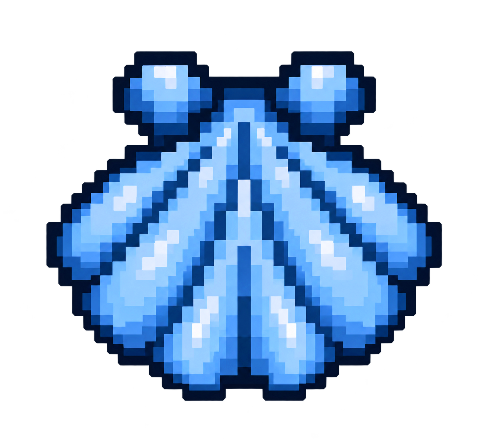

<div align="center">
  

  <h1>Pecten Studio</h1>

  <p>
    Make Game Boy Advance Metroidvanias from assets you create yourself.<br />
    Pixel art, music and rooms in the browser or on the desktop, built to a ROM you can play.
  </p>

  <p>
    <a href="https://studio.pecten.app"></a>
  </p>
</div>

<hr />

> **Note:** Early but working end to end. A sample game in [`sample/`](sample/) is made entirely from a studio project.

```sh
pnpm install
pnpm dev        # studio on sample/ at http://localhost:5173
```

Contributors and coding agents: see [AGENTS.md](AGENTS.md).
